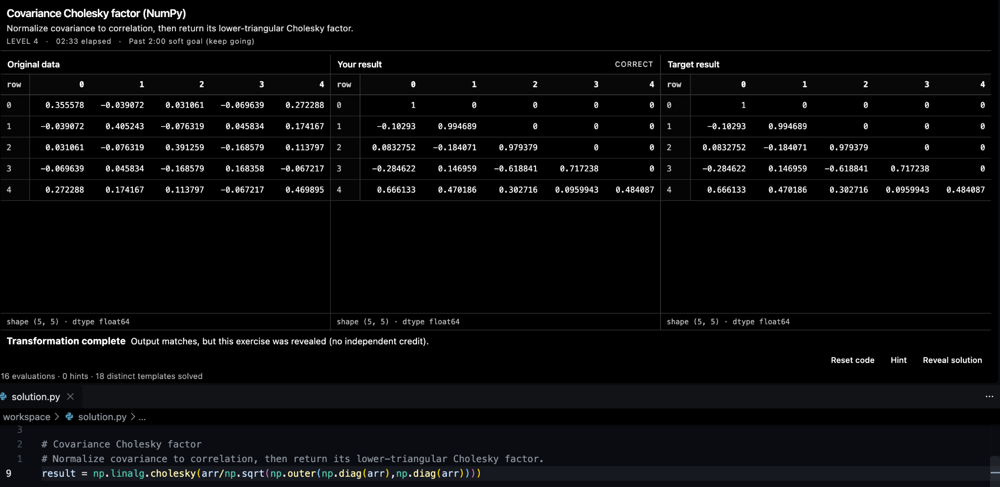

# DataGym

**Practice pandas and NumPy in your own VS Code editor.** DataGym presents the input dataset, your current result, and the expected result side by side. You write ordinary Python in `workspace/solution.py` and see whether the values and structure match.



## What it does

- **159 exercises** across nine JSON packs, from basic indexing to quantitative finance and numerical linear algebra
- Randomized, reproducible inputs and reference solutions
- Three panels: source data, live result, and target result
- Automatic evaluation of saved Python, with checks for type, labels, shape, dtype, and values
- Hints, reference answers, and step-by-step explanations
- Local SQLite progress tracking, difficulty and category filters
- VS Code commands and a `Cmd+Option+N` shortcut to move to the next exercise

This is an **early local-first release**. The extension is a VS Code panel, but it **requires this project folder and a Python virtual environment**; installing the VSIX alone does not install the Python engine or its dependencies. A fully self-contained extension is a possible future release.

## Requirements

- VS Code 1.90 or newer
- Python 3.11 or newer (tested with Python 3.13)
- `pandas` and `numpy`, installed as described below
- Node.js **only if you want to build the VSIX yourself**

### 1. Set up Python

Clone or download the source and open a terminal in its `DataGym` folder:

```bash
python3 -m venv .venv
source .venv/bin/activate
python -m pip install -r requirements.txt
```

On Windows, create the environment with `py -m venv .venv` and activate using `.venv\\Scripts\\activate` in Command Prompt, or `.venv\\Scripts\\Activate.ps1` in PowerShell.

### 2. Install the VS Code extension

Install a release VSIX via **Extensions → ... → Install from VSIX...**. If a VSIX is not available yet, build one from this repository:

```bash
cd extension
npx @vscode/vsce package
```

Then install the generated `datagym-vscode-0.1.0.vsix` through the same VS Code menu. Building the extension is separate from installing the Python dependencies.

### 3. Start practicing

1. Open the **entire `DataGym` repository folder** in VS Code (the one containing `app.py`).
2. Run **DataGym: Open Trainer** from the Command Palette (`Cmd+Shift+P` on macOS).
3. The extension starts the local Python backend, opens the DataGym panel, and opens `workspace/solution.py`.
4. Write your answer as `result = ...`. Evaluation runs after the file is saved. The included `.vscode/settings.json` enables Auto Save after 450 ms.
5. Press `Cmd+Option+N` or use **DataGym: Next Exercise** to advance. You can position the panel above the editor or alongside it.

**Next Exercise replaces `workspace/solution.py`.** Do not put work you want to keep in that training file. Progress is saved in `workspace/progress.sqlite3`; back it up before replacing a local installation.

The extension also provides **Hint**, **Reveal Answer**, and **Reset Code** commands. If you use VSCode-Neovim, the code remains in a normal editor with your existing bindings and IntelliSense.

If your Python interpreter is not at `.venv/bin/python` (or `.venv\\Scripts\\python.exe` on Windows), set **`datagym.pythonPath`** in VS Code settings to the interpreter's full path.

## Exercises and progress

- `exercise_packs/core.json` contains the starter exercises; the other packs cover market data, options, dispersion, feature engineering, time series, regimes, MOT, and NumPy.
- Each exercise has a unique ID, a dataset specification, instructions, a reference expression, and optional parameters, hints, and explanations.
- Adding a `.json` array in `exercise_packs/` makes another pack available after **Reload library**.
- The application records attempts, results, time, hints, and revealed answers locally in SQLite. It favors under-practiced exercises but does not implement a full spaced-repetition curriculum.

To inspect or validate the library:

```bash
python -m datagym.cli list
python -m datagym.cli validate
python -m datagym.cli stats
```

To add a simple exercise, create `exercise_packs/custom.json`:

```json
[
  {
    "id": "custom-price-filter",
    "title": "Filter high prices",
    "category": "Filtering",
    "difficulty": 1,
    "dataset": {"kind": "stocks", "rows": 10},
    "instructions": "Return a Series of prices above 100.",
    "reference": "df.loc[df['price'] > 100, 'price']",
    "hint": "Create a Boolean condition on the price column."
  }
]
```

The current dataset kinds include `stocks`, `trades`, `returns`, `matrix`, `vector`, `inline_dataframe`, `inline_array`, and the types in `datagym/quant_datasets.py`. The `reference` field contains a Python expression **without** `result =`. Parameters can use `{ "choices": [...] }` and are substituted into instructions, reference expressions, hints, and explanation steps.

## Project layout

```text
DataGym/
├── datagym/          # Python engine, evaluation, generators, SQLite and API
├── extension/        # VS Code extension source and manifest
├── static/           # Existing three-panel HTML/CSS/JavaScript UI
├── exercise_packs/   # JSON exercise definitions
├── tests/            # Python tests
├── scripts/          # Exercise-pack maintenance scripts
├── workspace/        # Local generated solutions and progress (not committed)
├── app.py            # Local backend entry point
├── requirements.txt
└── START_HERE.md      # Short installation guide
```

`datagym/ui_app.py` maintains the current session and local HTTP API, `executor.py` runs saved solutions in a short-lived Python worker, `compare.py` grades result objects, and `library.py` manages exercise definitions and progress. The extension displays the same UI inside a VS Code Webview and controls the backend; it doesn't duplicate the Python engine.

## Development

```bash
python -m pip install -r requirements-dev.txt
python -m pytest -q
python -m datagym.cli validate
node --check extension/extension.js
node --check static/app.js
node --test tests/test_extension.js
```

Release instructions are in [`docs/RELEASING.md`](docs/RELEASING.md). The source in `extension/` is authoritative; don't edit installed extension files inside `~/.vscode/extensions/`.

## Limitations and security

- Code runs **locally under your user account**. The worker has a timeout but is **not a security sandbox**. Run only code and exercise packs you trust; do not expose the backend publicly or execute untrusted submissions.
- The backend normally binds to `127.0.0.1:8765`. One local DataGym session uses that port.
- Previews truncate large outputs; grading uses the full result. Evaluation follows saved code, not unsaved editor buffers.
- The current VSIX needs the repository and Python dependencies. A browser view is still available with `python app.py`, but the VS Code extension is the intended workflow.

## License

MIT — see [`LICENSE`](LICENSE). Verify any third-party datasets or exercise content are redistributable before adding them.
