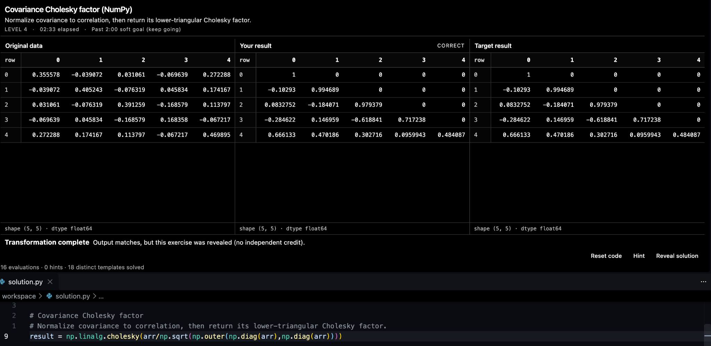

# DataGym

**An interactive pandas and NumPy training environment for VS Code.**

[**Install from VS Code Marketplace**](https://marketplace.visualstudio.com/items?itemName=charliekarstan.datagym-vscode) · [Report an issue](https://github.com/Charlie-Karstan/DataGym/issues) · [MIT License](LICENSE)

DataGym helps you build fluency with Python's data-processing libraries through practical, short-form exercises. Work in a native VS Code editor and compare your output against the expected result as you code.



## Features

- **159 exercises across nine packs**, covering pandas, NumPy, data cleaning, time series, linear algebra, market microstructure, options, and quantitative finance.
- **Three-panel feedback** showing the input dataset, your current result, and the expected output.
- **Automatic evaluation** of saved Python code, checking values, shape, labels, and data types.
- **Hints and worked solutions** with step-by-step explanations.
- **Previous and Next navigation** to revisit exercises and restore your code within a session.
- **Local progress tracking** with SQLite, randomized exercise inputs, and difficulty filters.

Solutions are written in an ordinary Python editor, so your existing VS Code extensions, keybindings, and editing workflow remain available.

## Getting started

**Requirements:** Desktop VS Code 1.90+ and Python 3.11+.

1. [Install DataGym from the VS Code Marketplace](https://marketplace.visualstudio.com/items?itemName=charliekarstan.datagym-vscode).
2. Open the Command Palette (`Cmd+Shift+P` on macOS).
3. Run **DataGym: Open Trainer**.
4. Write your solution in the generated `solution.py` editor, assigning the output to `result`.

DataGym creates its own Python environment and installs the required dependencies on first launch. This initial setup requires an internet connection.

**No repository clone or manual virtual environment setup is required.**

Use **Next Exercise** to continue or **Previous** to revisit a problem. On macOS, `Cmd+Option+N` advances to the next exercise.

## Implementation

DataGym consists of a VS Code extension and a local Python execution engine.

| Component | Responsibility |
|---|---|
| `extension/` | VS Code integration, commands, editor layout, runtime setup, and packaging |
| `datagym/` | Exercise generation, execution, result comparison, and progress tracking |
| `exercise_packs/` | JSON-defined exercises and reference solutions |
| `static/` | Three-panel training interface |
| `tests/` | Python and JavaScript regression tests |

The extension bundles the Python backend and exercise library. On first launch, it prepares an isolated environment and stores user data separately from the installed application files.

Solutions are evaluated in a separate local Python process. Results are compared against reference outputs using checks appropriate to pandas and NumPy objects.

## Development

The repository contains the full source code, tests, and exercise definitions. Cloning it is only necessary if you want to work on DataGym itself.

To run the tests locally, clone the repository and set up the development environment:

```bash
git clone https://github.com/Charlie-Karstan/DataGym.git
cd DataGym
python3 -m venv .venv
source .venv/bin/activate
python -m pip install -r requirements-dev.txt
```

Run the checks:

```bash
python -m pytest -q
python -m datagym.cli validate
node --check extension/extension.js
node --check static/app.js
node --test tests/test_extension.js
```

To build the VS Code extension:

```bash
cd extension
npx --yes @vscode/vsce package
```

The build bundles the current Python engine, frontend, and exercises into the VSIX.

## Contributing

DataGym is open source. Suggestions, bug reports, new exercises, and pull requests are welcome.

[Open an issue](https://github.com/Charlie-Karstan/DataGym/issues) to report a problem or propose an improvement. For code contributions, please include relevant tests and verify the existing suite before submitting a pull request.

## Notes

- A Python installation is required. DataGym provisions its own application dependencies.
- Progress is stored locally. Previous/Next exercise history currently lasts for the active session.
- User-written Python runs locally and is **not security-sandboxed**. Only execute code and exercise packs you trust.

## License

DataGym is available under the [MIT License](LICENSE).