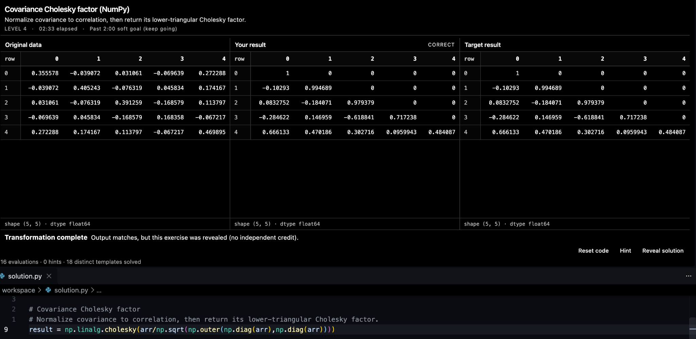

# DataGym

**Practice pandas and NumPy directly inside VS Code.**

DataGym turns data manipulation into interactive coding exercises. Write Python in your usual editor while comparing the input dataset, your live result, and the expected output.

## Features

- 159 pandas, NumPy, and quantitative Python exercises
- Live comparison of input, result, and target data
- Automatic solution evaluation
- Hints, reference solutions, and worked explanations
- Previous/Next navigation and code restoration
- Local progress tracking and difficulty filters
- Native VS Code editing, shortcuts, and IntelliSense

## Installation

**Requires desktop VS Code 1.90+ and Python 3.11+.**

1. Install DataGym from the Extensions Marketplace.
2. Open the Command Palette (`Cmd+Shift+P` on macOS).
3. Select **DataGym: Open Trainer**.
4. Write your solution in the generated `solution.py` editor.

If VS Code opens the DataGym workspace in Restricted Mode, use the Workspace Trust banner to trust that workspace. The trainer resumes automatically.

On first launch, DataGym automatically prepares a private Python environment and installs pandas and NumPy. Internet access is required for this initial setup.

There is **no need to clone the source code, open a particular project folder, or configure a DataGym virtual environment manually**.

## Usage

Assign your answer to `result`. DataGym evaluates saved code and displays the result alongside the target.

Use **Hint**, **Reveal Answer**, or **Reset Code** when needed. Navigate between exercises with **Previous** and **Next Exercise**.

On macOS, `Cmd+Option+N` advances to the next exercise.

## Open source

The full implementation, exercises, and tests are available on [GitHub](https://github.com/Charlie-Karstan/DataGym).

Bug reports, suggestions, and contributions are welcome through [GitHub Issues](https://github.com/Charlie-Karstan/DataGym/issues).

DataGym executes Python locally. The execution worker has a timeout but is not a security sandbox. Run only code you trust.

**License:** MIT.
